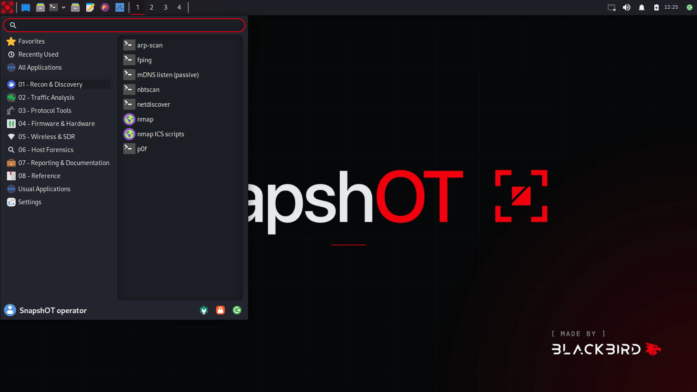
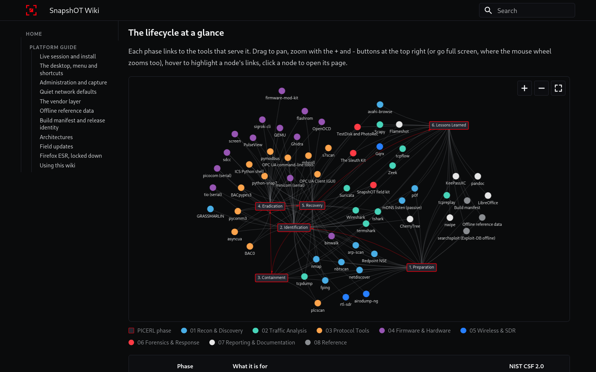
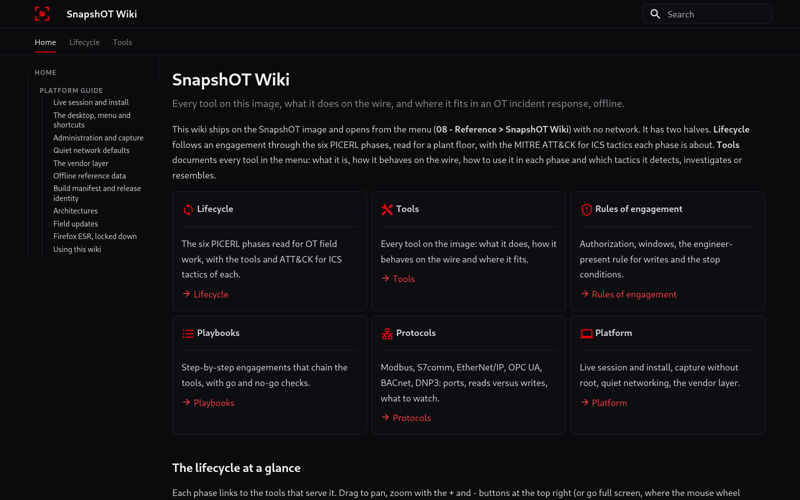

<p align="center">
  <picture>
    <source media="(prefers-color-scheme: dark)" srcset="branding/exports/snapshot-lockup-red-transparent.png">
    
  </picture>
</p>

<p align="center">
  <b>The offline, reproducible Debian image for OT incident response and assessment.</b><br>
  Made by <a href="https://github.com/Blackbird-Cyber">Blackbird Cyber, LLC</a>.
</p>

<!-- Static badges: shields.io cannot read the releases of a private repository.
     scripts/release.sh rewrites the release badge, the pin badge and the download links. -->
<p align="center">
  
  
  <a href="https://github.com/Blackbird-Cyber/SnapshOT/releases/tag/v0.2.1"></a>
  
  <a href="LICENSE"></a>
  <a href="https://creativecommons.org/licenses/by/4.0/"></a>
</p>

<table>
  <tr>
    <td width="50%"></td>
    <td width="50%"></td>
  </tr>
</table>

SnapshOT is a Debian 13 (trixie) live image for incident response and assessment
on OT and ICS networks. It boots from USB or in a VM to an Xfce desktop of OT
tools, documents each one in an offline wiki, and installs to an encrypted disk
with no network. It is built like Kali, with `live-build`, from one fixed
snapshot of the Debian archive.

## Why SnapshOT

- **Offline and reproducible.** Every build takes its packages from one snapshot.debian.org
  timestamp, and the image lists every package it carries in its build manifest.
- **Quiet on the wire.** Nothing on the image sends a packet until the operator brings an
  interface up, and the radio tools can only receive.
- **Documented for OT response.** The on-image wiki covers every tool, how it behaves on a plant
  network and where it fits in SANS PICERL, NIST CSF 2.0 and MITRE ATT&CK for ICS.
- **A field triage kit.** Read-only collectors for Windows (XP to 11) and Linux hosts run from a
  USB stick, and their results come back into a case folder with hash checks.
- **One client per image.** The offline installer encrypts the disk with LUKS2, and the laptop is
  wiped and re-imaged between engagements.

## Get SnapshOT

<p align="center">
  <a href="https://github.com/Blackbird-Cyber/SnapshOT/releases/download/v0.2.1/snapshot-amd64.hybrid.iso"></a>
  <a href="https://github.com/Blackbird-Cyber/SnapshOT/releases/download/v0.2.1/snapshot-arm64.hybrid.iso"></a>
</p>

<!-- release-table:start -->
**v0.2.1** (pre-release): Debian trixie pinned to snapshot.debian.org `20260901T022952Z`.

| Image | Hardware | Boot | Size | SHA-256 |
|---|---|---|---|---|
| [snapshot-amd64.hybrid.iso](https://github.com/Blackbird-Cyber/SnapshOT/releases/download/v0.2.1/snapshot-amd64.hybrid.iso) | x86-64 laptops and VMs | BIOS + UEFI | 1.75 GiB | `5dab970932abbe33ee7be69462b1d6e79f2f53b125088b50709af4fd7bfdf6f4` |
| [snapshot-arm64.hybrid.iso](https://github.com/Blackbird-Cyber/SnapshOT/releases/download/v0.2.1/snapshot-arm64.hybrid.iso) | arm64 VMs (UTM, Parallels, VMware Fusion on Apple Silicon) and UEFI arm64 hardware | UEFI | 1.71 GiB | `22a63281e5d9d997992b030c7ac993a27a9a2329ec525ba064ed52a6784046c0` |

Checksums: [`SHA256SUMS`](https://github.com/Blackbird-Cyber/SnapshOT/releases/download/v0.2.1/SHA256SUMS)
<!-- release-table:end -->

Read the [release notes](https://github.com/Blackbird-Cyber/SnapshOT/releases) of
the image you download, verify it, and write it to a USB stick (`/dev/sdX` is erased):

```sh
sha256sum -c --ignore-missing SHA256SUMS
sudo dd if=snapshot-amd64.hybrid.iso of=/dev/sdX bs=4M conv=fsync status=progress
```

For a VM, enable UEFI and give it 4 GB of RAM and a 20 GB disk (arm64 image for
UTM, Parallels or VMware Fusion on Apple Silicon). The live user is `snapshot`,
password `live`; **Install SnapshOT** on the desktop runs the offline installer.
macOS, Windows, Etcher, Rufus, Ventoy, split downloads and the install:
[docs/getting-started.md](docs/getting-started.md).

## What's on the image

Eight numbered menu folders, in the order of an engagement ([docs/desktop.md](docs/desktop.md)):

| Folder | What it is for | Tools |
|---|---|---|
| 01 - Recon & Discovery | Find the hosts, services and controllers on a segment, passively first and actively only with approval. | nmap (with its ICS scripts), *Redpoint NSE*, netdiscover, arp-scan, p0f, fping, nbtscan, passive mDNS listen (tshark) |
| 02 - Traffic Analysis | Capture, decode, replay and inspect network traffic, including the industrial protocols on it. | Wireshark, tshark, termshark, tcpdump, tcpflow, tcpreplay, Suricata, Scapy |
| 03 - Protocol Tools | Speak Modbus, S7comm, EtherNet/IP, OPC UA and BACnet to a device, to read it or, with approval, to write to it. | mbpoll; *pymodbus, pycomm3, BACpypes3, BAC0, asyncua and python-snap7* in the *ICS Python shell*, with the *OPC UA command-line tools*; *opcua-client* (GUI, amd64 only); *plcscan* |
| 04 - Firmware & Hardware | Acquire and examine firmware, talk to serial consoles and debug ports, and capture signals on a bench. | binwalk, flashrom, OpenOCD, sigrok-cli, PulseView, sdcc, minicom, picocom, tio, screen, QEMU |
| 05 - Wireless & SDR | Survey Wi-Fi and the radio spectrum around a site, receive only, for transmitters the asset inventory does not explain. | airodump-ng, rtl-sdr (rtl_eeprom dongle check, rtl_power), gqrx |
| 06 - Host Forensics | Collect evidence from hosts with the field kit and examine disks and images without changing them. | SnapshOT field triage kit (USB prepare and import, Windows and Linux collectors), The Sleuth Kit, TestDisk/PhotoRec |
| 07 - Reporting & Documentation | Take notes, capture screens, keep secrets, write the report and wipe media between clients. | LibreOffice, CherryTree, Flameshot, pandoc, KeePassXC, nwipe |
| 08 - Reference | Offline reference data, the build manifest of this image and the SnapshOT Wiki. | offline reference folder, the build manifest, the SnapshOT Wiki |

**The SnapshOT Wiki** documents every tool above: what it does, how it behaves on the
wire, a quick start and where it fits in each response phase, with rules of
engagement, playbooks and protocol primers. Search, tags and the graphs work with no
network. It is the home page of Firefox ESR, which is locked down so it makes no
connection on its own ([docs/wiki.md](docs/wiki.md)).



**The field triage kit** is a USB stick that SnapshOT prepares. Its collectors run on
Windows (PowerShell 2.0 or plain `cmd.exe`) and Linux (POSIX sh, BusyBox included) and
write only to the stick; the import checks every hash and appends to the case's
chain-of-custody log ([docs/fieldkit.md](docs/fieldkit.md)).

Tools in *italics* are not packaged by Debian: the vendor layer pins them in
[`vendor/sources.lock`](vendor/sources.lock) and installs each under
`/opt/snapshot/<tool>/` with its own runtime ([docs/vendoring.md](docs/vendoring.md)).

## Security posture

- **Quiet on the wire.** avahi and systemd-timesyncd are masked, ModemManager is
  not installed, LLMNR, mDNS, connectivity checks, automatic wired profiles and
  IPv6 autoconfiguration are off, and Firefox ESR runs under a policy that stops
  it calling home. Interfaces come up only when the operator brings them up.
- **Receive-only radio.** RTL-SDR and gqrx can only listen, and airodump-ng is the
  only 802.11 tool: enough to spot a transmitter the asset inventory does not explain.
- **Encryption at rest.** The installer puts the root filesystem in LUKS2.
  `/boot` holds only the kernel, initramfs and GRUB files and is not encrypted.
- **Small, fixed install.** No recommended packages and no network: Calamares copies the live image.
- **One client per image.** Re-image between engagements; [docs/updates.md](docs/updates.md)
  covers the signed offline USB mirror for the exception.
- **Scope.** A defensive and assessment platform for authorized OT engagements, with an
  OT-focused, passive-first default toolset.

## amd64 and arm64 images

Both images come from the same tree and pin. They differ only where the hardware
or upstream software requires it:

| | amd64 | arm64 |
|---|---|---|
| Use it on | x86-64 laptops, desktops and VMs (VMware, VirtualBox, Hyper-V, QEMU/KVM) | arm64 VMs on Apple Silicon (UTM, Parallels, VMware Fusion) and UEFI arm64 hardware; it does not boot an Apple Silicon Mac directly |
| Live ISO boots with | BIOS or UEFI | UEFI only |
| Installed bootloader | GRUB for BIOS (`grub-pc-bin`) or UEFI (`grub-efi-amd64`), matching how the live system started; EFI system partition only on UEFI installs | GRUB for UEFI (`grub-efi-arm64`) |
| Kernel | Debian `linux-image-amd64` | Debian `linux-image-arm64` |
| CPU microcode | `intel-microcode`, `amd64-microcode` | none (x86-only packages) |
| OPC UA GUI client (*opcua-client*) | yes | no: PyQt5 publishes no Linux aarch64 wheels, and the vendor layer installs wheels only |
| The Sleuth Kit CLI, TestDisk/PhotoRec | yes | yes |

Everything else is the same on both. Launchers for amd64-only tools ship on both
images and are hidden on arm64.

## Reproducible builds

Every apt source in the build points at one snapshot.debian.org timestamp
(`SNAPSHOT_DEBIAN_PIN` in [`config/snapshot.env`](config/snapshot.env)), and files
are stamped with the matching `SOURCE_DATE_EPOCH`, so two builds of a release
resolve the same packages. Each image records where it came from in two files:

- `/etc/snapshot-release`: version, architecture, Debian pin, `SOURCE_DATE_EPOCH`, build commit.
- `/usr/share/snapshot/reference/BUILD-MANIFEST.txt`: the same, plus the kernel, every package and the vendor layer.

[`scripts/verify-repro.sh`](scripts/verify-repro.sh) builds twice from a clean
state and compares the two ISOs, running diffoscope when they differ.

## Build from source

```sh
python3 scripts/vendor.py fetch --arch all     # online (Docker): the vendor layer; re-run when the lock or a requirements.in changes
scripts/check-installer.sh                     # validate the installer configuration
scripts/check-desktop.sh                       # validate the desktop menu and launchers
scripts/check-fieldkit.sh                      # validate the field kit collectors and USB tools
scripts/check-wiki.sh                          # build and validate the SnapshOT Wiki
scripts/check-firefox-quiet.sh                 # prove Firefox ESR sends nothing on its own (slow)
scripts/test-vendor-hooks.sh [arch]            # install the fetched vendor layer in a trixie container and smoke-test it
SNAPSHOT_ARCH=arm64 docker/build-in-docker.sh  # arm64, in the build container (native on Apple Silicon)
docker/build-in-docker.sh                      # amd64 (emulated on Apple Silicon, much slower)
sudo scripts/build.sh                          # directly on a Debian trixie host
```

The ISO lands in the repository root; [docs/build.md](docs/build.md) has the requirements
and [CONTRIBUTING.md](CONTRIBUTING.md) says how to propose a change.

## Documentation

| Document | What it covers |
|---|---|
| [docs/getting-started.md](docs/getting-started.md) | Download, verify, write to USB, run in a VM, the live session and the install |
| [docs/offline-install.md](docs/offline-install.md) | The offline LUKS2 install: disk layout, first boot, administration, module configuration, QA checklist |
| [docs/desktop.md](docs/desktop.md) | The Xfce desktop, the menu folders and how the defaults are applied |
| [docs/fieldkit.md](docs/fieldkit.md) | The field triage kit: workflow, profiles, what each collector collects, checks |
| [docs/wiki.md](docs/wiki.md) | The SnapshOT Wiki: authoring guide, data files, graphs, checks, the Firefox ESR lockdown |
| [docs/updates.md](docs/updates.md) | Re-imaging, and the signed offline USB mirror |
| [docs/build.md](docs/build.md) | Building the image, the offline mechanics and reproducibility |
| [docs/vendoring.md](docs/vendoring.md) | The vendor layer: the lock, the fetch step, recipes and licenses |
| The SnapshOT Wiki | On the image at `/usr/share/snapshot/wiki`; sources in [`packages/snapshot-wiki/docs/`](packages/snapshot-wiki/docs/) |

## Repository layout

| Path | Contents |
|---|---|
| [`auto/`](auto/), [`config/`](config/) | The live-build project: snapshot pin, package lists, hooks, files copied into the image, boot menu |
| [`packages/`](packages/) | SnapshOT's own Debian packages: themes, boot branding, menu, field kit, wiki, installer settings |
| [`branding/`](branding/) | Brand assets, the source for the copies in `packages/` |
| [`vendor/`](vendor/) | The lock and per-arch requirement files for the vendor layer, source-build recipes and setup steps |
| [`scripts/`](scripts/) | Build, vendor fetch and install, checks, reproducibility test, update USB, release |
| [`docker/`](docker/) | The build container |

## License and trademarks

- Code, configuration and packaging: [Apache License 2.0](LICENSE) (see [`NOTICE`](NOTICE)).
- The SnapshOT Wiki and `docs/`: [CC BY 4.0](https://creativecommons.org/licenses/by/4.0/).
- Debian packages and vendored tools keep their own licenses: see
  `/usr/share/doc/<package>/copyright` and `BUILD-MANIFEST.txt` on the image. Files
  derived from Kali, live-build and Xfce keep their GPL or LGPL license;
  [`REUSE.toml`](REUSE.toml) lists every exception.
- MITRE ATT&CK for ICS data: [MITRE's terms of use](LICENSES/LicenseRef-MITRE-ATTACK-Terms.txt).
- The SnapshOT name, mark and lockups are trademarks of Blackbird Cyber, LLC:
  [TRADEMARKS.md](TRADEMARKS.md) says how to use them and how to rebrand a fork.
- **No warranty.** SnapshOT is provided as is, without warranty of any kind, and
  Blackbird Cyber, LLC accepts no liability for its use, to the extent the law allows
  (Apache License 2.0, sections 7 and 8; CC BY 4.0, section 5). Every tool on the
  image can disturb a control system. Running one is your decision and your
  responsibility: written authorization first, and the wiki's rules of engagement always.

<p align="center">
  SnapshOT is for authorized OT engagements only.<br>
  <a href="https://github.com/Blackbird-Cyber">Blackbird Cyber on GitHub</a> · <a href="https://github.com/Blackbird-Cyber/SnapshOT/issues">Issues</a> · <a href="SECURITY.md">Security policy</a>
</p>
